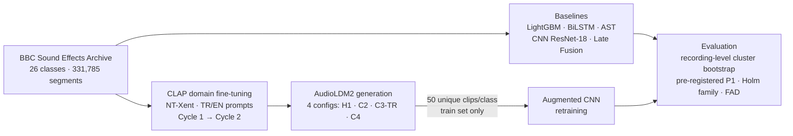

# HybridAudioGenTR

**Does a text-to-audio diffusion model, steered by a domain-adapted CLAP encoder, measurably improve a real-world sound classifier — under a leakage-aware, multi-seed, pre-registered protocol on a single consumer GPU?**


Code and experimental artefacts for the paper:

> **Fine-Tuned CLAP-Guided Text-to-Audio Generative Augmentation for Environmental Sound Classification: A Controlled Multi-Configuration Evaluation**
> Fatih Doğan Cellat, Fatma Noyan Tekeli — *IEEE Access, revised manuscript (Access-2026-36903), October 2026*

> **Status (October 2026):** the revised manuscript has been resubmitted. Its code and results are under the
> git tag **`v2-resubmission`** (`results/v2/`, scripts `15_…`–`26_…`, analysis plan `docs/v2_onkayit.md`).
> The first submission is frozen under the tag `v1-submission` and in `results/v1/`; several of its claims
> were revised or withdrawn after an audit (see `results/v1/README.md` and the revision summary below).

The study evaluates whether synthetic audio generated by **AudioLDM2**, guided by a
**domain-adapted CLAP** model (fine-tuned with bilingual Turkish/English prompts via NT-Xent on the
classifier's training partition only), improves a ResNet-18 classifier on a 26-class subset of the
**BBC Sound Effects Archive**. Every configuration is trained with paired seeds; recordings are the unit
of statistical inference (class-stratified cluster bootstrap); a single primary hypothesis was fixed in
`docs/v2_onkayit.md` (commit `2a3f20b`) before any augmented run of the revised protocol.

## Pipeline at a glance



## Key results (revision, v2 — tag `v2-resubmission`)

| Finding | Evidence (`results/v2/`) |
|---|---|
| Pre-registered primary hypothesis supported: C4′ clips raise Group A (dog, bird, weather) macro-F1 | +0.018, 95% CI [+0.004, +0.033], p = 0.010 (5 paired seeds, validation + test); test only +0.018, p = 0.044 (post hoc) — `ikincil_analiz_tam.json`, `sonradan_duyarlilik.json` |
| No gain for the three lowest-F1 classes, the control class or a frozen BEATs classifier | Group B −0.008 [−0.023, +0.007]; BEATs C4′ −0.008 [−0.020, +0.004] |
| CLAP fine-tuning improves the encoder but adds no measurable downstream benefit | C4′ − H1 +0.006 [−0.010, +0.022], p = 0.42 |
| Secondary patterns are exploratory | Dose 25→200 clips: −0.001 … +0.017 (p = 0.084 at 200); SpecAugment + C4′ vs SpecAugment +0.020, Holm-adjusted p = 0.16 |
| In this setting, FAD and CLAP alignment do not track downstream benefit | `kalite_metrikleri.json` |
| Pitfalls documented | fixed-seed diversity collapse, non-deterministic FAD, silent fp16 failure of CLAP fine-tuning, evaluation leakage via encoder fine-tuning, segment-level significance testing |

## Key results (first submission, v1 — superseded)

> Kept for the record. Several rows below were revised or withdrawn in v2: the segment-level p-values
> treat segments of the same recording as independent; CLAP fine-tuning had no effect in the v1 runs;
> the Turkish-prompt claim is withdrawn; the "+Both" SpecAugment run used the H1 clips.

| Finding | Evidence |
|---|---|
| Targeted augmentation improves the three target classes in all four generation configurations (H1, C2, C3, C4) | Segment-level McNemar p < 10⁻⁵ in every configuration; robust to Holm–Bonferroni |
| The strongest configuration survives a conservative recording-level analysis | Cluster bootstrap: C4 +6.3 pts on combined targets, 95% CI [+1.7, +11.5], p = 0.004 |
| The heterogeneous catch-all control class does not benefit | ns at every level of analysis (in v1 the control received synthetic clips only in H1; see `results/v1/README.md`) |
| First demonstration of Turkish prompt-guided generation with significant downstream benefit | C3 (Turkish prompts): p < 10⁻⁵ |
| FAD does not track downstream benefit | FAD-identical configurations differ sharply in task gains; Turkish run has the worst FAD but the most consistent gains |
| Two methodological pitfalls identified & fixed | Fixed-seed diversity collapse (50 clips → 5–12 unique); non-deterministic FAD |
| Conventional comparison | SpecAugment ≈ generative on the targets (p = 0.81); stacking both degrades the targets (p = 0.017) |

Every numeric value reported in the first submission can be traced to a JSON file under `results/v1/`
(indexed in [`results/v1/README.md`](results/v1/README.md), including known issues found during revision).

## Repository layout

```
├── src/                    Core package
│   ├── data/               labels, preprocessing, feature extraction, PyTorch dataset
│   └── models/             LightGBM / CNN (ResNet-18) / BiLSTM / AST definitions
├── scripts/                Reusable numbered pipeline (run in order)
│   ├── 00*_…               Data organisation, mel pre-compute, filename translation
│   ├── 01–04_…             Feature extraction, classical + deep baselines, late fusion
│   ├── 05–07_…             AudioLDM2 generation, deterministic FAD, iterative augmentation loop
│   ├── 08–09_…             CLAP domain fine-tuning (TR/EN, NT-Xent) and integration
│   ├── 12_…, 13*_…         McNemar (segment level), file-level McNemar, cluster-robust bootstrap
│   ├── 14_…                Classifier-based validation of synthetic clips
│   ├── 15_…–26_…           Revision (v2): multi-seed training, recording-level analysis, memorization,
│   │                       BEATs, quality metrics, cost, figures, supplementary tables, post hoc checks
│   ├── kosu_v2/            Run queue for the revision (PowerShell; resumable, pausable)
│   ├── denetim/            Audit scripts (CLAP diagnosis, data coverage, citation checks)
│   ├── cesitlilik_kontrol.py  MD5 check for duplicate synthetic clips
│   └── v1/                 First-submission analyses, paper figures and overnight run drivers
├── notebooks/              Exploratory notebooks (LightGBM baseline, model selection, CNN/LSTM)
├── results/
│   ├── v1/                 First-submission outcomes as small JSON files, with an index (README)
│   ├── v2/                 Revision outcomes (JSON), predictions index, figures, supplementary tables
│   └── denetim/            Audit outputs
├── docs/v2_onkayit.md      Pre-registered analysis plan of the revision (committed 4 Oct 2026, 2a3f20b)
├── docs/v1/                First-submission reproduction guide, project plan, class-mapping notes
├── data/processed/         Small tracked artefacts: bilingual prompts, filename translations,
│                           audio–caption pairs (ses_metin_eslestirme.parquet)
└── requirements.txt
```

Large artefacts (raw BBC audio, mel cache, synthetic clips, model checkpoints, generated
reports/papers) are intentionally **not** tracked — see `.gitignore`.

## The 26 classes

`ucak_sesleri, tren_sesleri, kara_tasitlari, gemi_tekne_sesleri, at_sesleri, kopek_sesleri,
kus_sesleri, diger_hayvanlar, hava_olaylari, su_sesleri, doga_atmosferi, sehir_atmosferi,
kalabalik_sesleri, cocuk_bebek_sesleri, silah_patlama, acil_servis, endustri_fabrika,
insaat_sesleri, ev_ici_sesler, kapi_sesleri, saat_can_sesleri, ayak_sesleri, ofis_iletisim,
tarim_ciftlik, spor_eglence, dini_mekan`

Assigned by keyword rules over BBC folder and file names (`src/data/labels.py`): 15,356 of the
archive's 16,008 unique recordings match a rule (652 are excluded); duplicate copies are removed by
BBC catalog number. File-level stratified 70/15/15 split with `seed = 42`
(10,748 / 2,304 / 2,304 files → 331,785 five-second segments, test set 48,144 segments).

## Setup

```bash
conda create -n audiogen python=3.10
conda activate audiogen
pip install torch torchvision torchaudio --index-url https://download.pytorch.org/whl/cu118
pip install -r requirements.txt
```

Additional components used by the revision (v2):

- **R ≥ 4.4 with `lme4`** for the mixed-model sensitivity analysis (`16_birincil_analiz.py`); set the
  `RSCRIPT` environment variable if `Rscript` is not on `PATH`.
- **BEATs (iter3+, AS2M)** for the second classifier (`19_beats_probe.py`): place
  `BEATs_iter3_plus_AS2M.pt` and the BEATs source files (`BEATs.py`, `backbone.py`, `modules.py` from
  microsoft/unilm) in `checkpoints/beats/`; the script verifies the checkpoint's SHA-256.
- The PowerShell run drivers in `scripts/kosu_v2/` assume a local conda path for `python.exe`; adjust the
  `$py` variable at the top of each driver.

The revised experiments ran on a single NVIDIA RTX 3060 (12 GB); the generation and training runs of the
revision took about 176 GPU-hours (`results/v2/hesaplama_maliyeti.json`).

## Data

The BBC Sound Effects Archive is publicly available under the RemArc license at
<https://sound-effects.bbcrewind.co.uk/>. After downloading, organise the recordings with:

```bash
python scripts/00_organize_data.py            # dry run (report only)
python scripts/00_organize_data.py --execute  # move files into data/raw/<class>/
python scripts/00b_precompute_mel.py          # log-mel cache (128 mels, fft 1024, hop 256)
```

## Reproducing the revised paper (v2)

`git checkout v2-resubmission`. The run queue `scripts/kosu_v2/kuyruk_v2.ps1` executes the training steps in
order and can be paused (`durdur.ps1`) and resumed; `gece_beats.ps1` runs the BEATs analysis.

| Stage | Script(s) | Output (`results/v2/`) |
|---|---|---|
| CLAP fine-tuning on the training partition (Cycle 1 / 2, fp32) | `08_clap_finetune.py`, `09_integrate_clap.py` | `clap_finetune_dongu*.json`, `clap_bolme_*.json`, `clap_entegrasyon_*.json` |
| Generation (C2′, C3′, C4′, dose clips; H1 clips reused) | `05_generate_audio.py` (via `kuyruk_v2.ps1`) | `data/synthetic_v2/` (not tracked) |
| Classifier training, paired seeds | `15_siniflandirma_v2.py` | `siniflandirma/*.json`, `tahminler/*.npz` |
| Primary and secondary analyses (pre-registered) | `16_birincil_analiz.py`, `20_ikincil_aile.py` | `birincil_analiz_*.json`, `ikincil_analiz_tam.json` |
| Memorization, BEATs, quality metrics, cost | `17_…`, `19_…`, `21_…`, `22_…` | `ezber_analizi_*.json`, `siniflandirma/beats_*`, `kalite_metrikleri.json`, `hesaplama_maliyeti.json` |
| Post hoc sensitivity (not pre-registered) | `26_sonradan_duyarlilik.py` | `sonradan_duyarlilik.json` |
| Figures, manuscript and supplementary tables | `23_…`, `25_…`, `24_…` | `sekiller/`, `makale_tablolari.json`, `ek_tablolar.md` |

## Reproducing the first submission (v1)

The end-to-end order, expected runtimes and output files are documented in
[`docs/v1/YENIDEN_URETIM_PIPELINE.md`](docs/v1/YENIDEN_URETIM_PIPELINE.md). To reproduce the first
submission exactly, check out the tag: `git checkout v1-submission`. In short:

| Stage | Script(s) | Output |
|---|---|---|
| Baselines (5 model families) | `01_…`, `02_…`, `02b_…`, `03_…`, `04_…` | `results/v1/*_sonuclar.json` |
| CLAP fine-tuning (Cycle 1 / Cycle 2) | `08_clap_finetune.py`, `09_integrate_clap.py` | `results/v1/clap_finetune_*.json` |
| Synthetic generation (H1/C2/C3/C4) | `05_generate_audio.py` (+ `scripts/v1/kosu/coherent_deney.ps1`) | `data/synthetic_turcoh*/` |
| Deterministic FAD | `06_measure_fad.py` | `results/v1/fad_sonuclar_coh*.json` |
| Augmented training | `07_iterative_loop.py` | `results/v1/iteratif_loop_coherent*.json` |
| Significance (segment) | `12_mcnemar_test.py`, `v1/mcnemar_coherent.py` | `results/v1/mcnemar_coh*.json` |
| Significance (cluster-robust) | `13_mcnemar_dosya_duzeyi.py`, `13b_kume_direncli_test.py` | `results/v1/mcnemar_dosya_duzeyi.json`, `results/v1/kume_direncli_test.json` |
| SpecAugment comparison | `scripts/v1/kosu/gece_specaug.ps1`, `v1/k6_specaug.py` | `results/v1/*specA*.json` |
| Paper figures & tables | `scripts/v1/figurler/…` | `outputs/makale_figurleri/` |

## Citation

The paper is under review at IEEE Access; this entry will be updated upon publication.
Until then:

```bibtex
@misc{cellat2026hybridaudiogen,
  author = {Cellat, Fatih Do{\u{g}}an and Noyan Tekeli, Fatma},
  title  = {Fine-Tuned CLAP-Guided Text-to-Audio Generative Augmentation for
            Environmental Sound Classification: A Controlled
            Multi-Configuration Evaluation},
  year   = {2026},
  note   = {Revised manuscript under review at IEEE Access. Code: https://github.com/victor-nescio/HybridAudioGenTRv2}
}
```

GitHub's *"Cite this repository"* button (from `CITATION.cff`) produces the same entry.

## Authors

- **Fatih Doğan Cellat** — Department of Statistics, Yıldız Technical University · Head of AI, HDI Sigorta (Talanx Group) — <fdcellat@gmail.com>
- **Fatma Noyan Tekeli** — Department of Statistics, Yıldız Technical University

This work was supported by the Yıldız Technical University Scientific Research Projects
Coordination Unit under project FDK-2026-7516.

## License

The code in this repository is released under the [MIT License](LICENSE).
The BBC Sound Effects Archive audio is **not** covered by this license — it is
distributed by the BBC under the RemArc license and must be obtained from the
official archive.

## Notes

- Code comments and script names are partly in Turkish (the project's working language);
  the pipeline structure above and the reproduction guide should make navigation easy.
- The BBC audio itself is **not** redistributed here; obtain it from the official archive.
